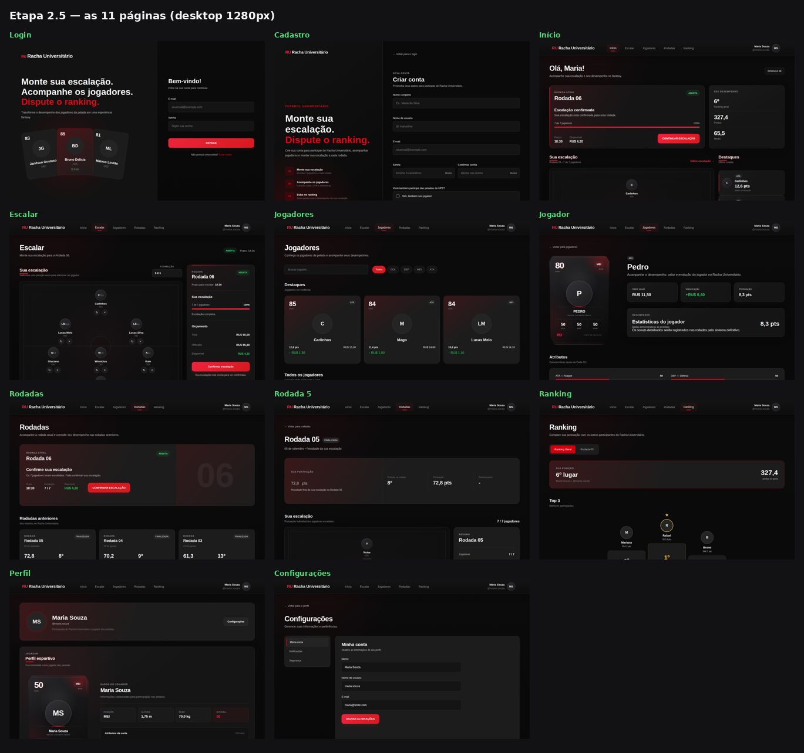
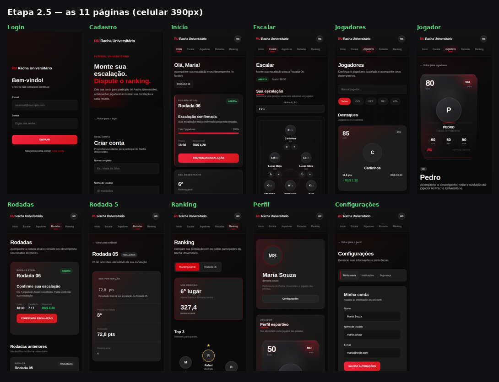

# Racha Universitário (RU)

> Plataforma acadêmica de fantasy football para o futebol amador universitário, inspirada na experiência da Pelada UPE.

**Status:** protótipo frontend funcional, com evolução Full Stack planejada.  
**Instituição:** Universidade de Pernambuco (UPE) — Campus Garanhuns · **Período:** 2026.2

O **Racha Universitário (RU)** combina escalações virtuais, cards de jogadores e estatísticas de futebol amador. Cada usuário pode escalar **sete atletas** (um goleiro e seis jogadores de linha), acompanhar rodadas e rankings demonstrativos e gerenciar um orçamento em **RUCoin (RU$)**. Como os times das peladas são sorteados, o fantasy não depende de clubes fixos: o foco está nos jogadores.

> **Atenção:** esta versão é uma demonstração **sem backend, banco de dados ou autenticação real**. Os dados de conta e escalação são armazenados no navegador. **Não utilize senhas reais.**

## Sumário

- [Origem e motivação](#origem-e-motivação)
- [Referências e diferenciais](#referências-e-diferenciais)
- [Demonstração](#demonstração)
- [Funcionalidades](#funcionalidades)
- [O que funciona e o que é simulado](#o-que-funciona-e-o-que-é-simulado)
- [Regras do jogo](#regras-do-jogo)
- [Tecnologias](#tecnologias)
- [Estrutura do projeto](#estrutura-do-projeto)
- [Como executar](#como-executar)
- [Roteiro de demonstração](#roteiro-de-demonstração)
- [Persistência e validações](#persistência-e-validações)
- [Identidade visual](#identidade-visual)
- [Publicação no GitHub Pages](#publicação-no-github-pages)
- [Limitações e próximos passos](#limitações-e-próximos-passos)
- [Equipe e créditos](#equipe-e-créditos)

## Origem e motivação

A ideia do RU já vinha sendo discutida entre os integrantes da equipe antes da realização do trabalho. Durante a escolha de temas em uma disciplina da Licenciatura em Computação, surgiu a oportunidade de transformá-la em um projeto acadêmico.

A inspiração direta foi a **Pelada UPE**, que reúne jogadores da Universidade de Pernambuco e de outras instituições, com organização realizada por integrantes da UPE. A proposta é levar para essa comunidade a experiência de acompanhar o próprio desempenho e o dos amigos como em um fantasy game: consultar cartas e estatísticas, montar escalações e disputar rankings.

O projeto aproxima conceitos estudados na graduação de uma atividade presente no cotidiano da equipe, com potencial de evolução para uma aplicação web completa.

## Referências e diferenciais

As referências de concepção foram:

- **Cartola FC:** escalação de atletas, rodadas, pontuação, orçamento e valorização.
- **Appito:** contexto do futebol amador, perfis e estatísticas de participantes de peladas.
- **FIFA / EA Sports FC:** apresentação dos jogadores em cards, atributos e avaliação geral (*overall*, ou OVR).

A pesquisa inicial também considerou alternativas de fantasy games e organização de partidas. Essas referências serviram para comparar propostas, não significam integração, parceria ou reprodução dos aplicativos citados.

**Diferencial:** os atletas do fantasy são participantes de uma pelada universitária, e não jogadores contratados por clubes permanentes. Os times reais podem mudar a cada encontro, mas o histórico e a evolução individual dos jogadores continuam sendo o centro da proposta.

O nome **Racha Universitário (RU)** identifica o projeto; sua moeda virtual é a **RUCoin (RU$)**.

## Demonstração

**Demonstração online:** [Acessar o Racha Universitário](https://PedroHSX.github.io/racha-universitario/)

### Desktop



### Mobile



## Funcionalidades

| Página | Arquivo | Função |
| --- | --- | --- |
| Login | `index.html` | Entrada na conta demonstrativa |
| Cadastro | `cadastro.html` | Cadastro e, para participantes da pelada, dados de posição, altura e peso |
| Início | `home.html` | Rodada atual, situação da escalação e destaques |
| Escalar | `escalar.html` | Campo, formações, orçamento e confirmação |
| Jogadores | `jogadores.html` | Busca, filtro e escolha de atletas |
| Jogador | `jogador.html?id=…` | Carta RU, valor, valorização e pontuação |
| Rodadas | `rodadas.html` | Rodada atual e histórico |
| Rodada | `rodada.html?rodada=N` | Pontuação, escalação, destaques e ranking disponível |
| Ranking | `ranking.html` | Classificação geral e por rodada quando disponível |
| Perfil | `perfil.html` | Dados e carta do usuário, quando aplicável |
| Configurações | `configuracoes.html` | Edição de dados, preferências e saída da sessão |

A interface é responsiva, incluindo navegação horizontal rolável em telas pequenas e adaptação do campo de escalação.

## O que funciona e o que é simulado

### Funcionalidades implementadas no protótipo

- Cadastro com validações; a senha **não é armazenada**.
- Alteração de nome, nome de usuário e e-mail.
- Escolha, troca e remoção de jogadores; mudança de formação e cálculo do orçamento.
- Confirmação de escalação completa e dentro do orçamento.
- Invalidação da confirmação se a escalação ou a formação for alterada.
- Persistência de escalação e formação entre páginas e recarregamentos.
- Busca e filtros de jogadores; navegação entre rodadas.

### Funcionalidades demonstrativas ou dados fixos

| Recurso | Situação nesta versão |
| --- | --- |
| Login | Confere o e-mail cadastrado, **mas não valida a senha**; aceita qualquer texto de pelo menos oito caracteres |
| Sessão | Flag `ruSessao` no `sessionStorage`; **não é autenticação segura** |
| Contas | Uma conta por navegador; novo cadastro substitui a anterior e limpa a escalação |
| Troca de senha | Interface com validação, sem alteração efetiva de senha |
| Notificações | Preferências salvas, sem envio de avisos |
| Rodadas | Rodada 06 aberta e rodadas 1–5 finalizadas; datas e prazo demonstrativos |
| Rankings | Dados fixos; somente a rodada 5 tem ranking específico |
| Jogadores | 19 atletas demonstrativos, com posições, OVR, valores e pontos definidos nos arquivos JavaScript |
| Atributos ATA, DEF e HAB | Valor provisório 50, sem cálculo real por scouts |
| Cards do Login | Ilustrações demonstrativas; não representam autenticação ou perfis reais |

## Regras do jogo

- **Escalação:** sete jogadores por rodada — **um goleiro e seis de linha**.
- **Posições:** GOL, DEF, MEI e ATA.
- **Formações:** `2-2-2` (padrão), `3-2-1`, `3-1-2`, `2-3-1`, `2-1-3`, `1-3-2` e `1-2-3` (DEF–MEI–ATA).
- **Orçamento demonstrativo:** **RU$ 90,00** por escalação.
- **Restrições:** não repetir o mesmo atleta e selecionar apenas jogadores elegíveis para a posição escolhida.
- **Confirmação:** requer sete jogadores e custo dentro do orçamento.

O cálculo definitivo de pontuação, a evolução dos atributos e a valorização dos cards dependem da implementação posterior das estatísticas reais das partidas (*scouts*).

## Tecnologias

**Protótipo publicado:** HTML5, CSS3 e JavaScript puro, sem framework e sem etapa de build. Utiliza `localStorage` para dados demonstrativos, `sessionStorage` para a flag de sessão e fonte Inter do Google Fonts, com fonte alternativa quando indisponível.

**Evolução Full Stack planejada:** React (interface), Java com Spring Boot (regras de negócio e APIs REST) e PostgreSQL (persistência). Essas tecnologias **ainda não integram este protótipo**.

## Estrutura do projeto

```text
racha-universitario/
├── css/
│   └── style.css
├── docs/
│   ├── folha_desktop.png
│   └── folha_mobile.png
├── imgs/
│   ├── apple-touch-icon.png
│   ├── favicon-32.png
│   └── favicon.svg
├── js/
│   ├── config.js
│   ├── escalar.js
│   ├── jogador.js
│   ├── jogadores.js
│   ├── rodada.js
│   ├── rodadas-data.js
│   ├── rodadas.js
│   └── script.js
├── .gitignore
├── .nojekyll
├── cadastro.html
├── configuracoes.html
├── escalar.html
├── home.html
├── index.html
├── jogador.html
├── jogadores.html
├── perfil.html
├── ranking.html
├── README.md
├── rodada.html
└── rodadas.html
```

- `css/style.css`: estilos compartilhados; a ordem das regras na cascata importa.
- `js/config.js`: configurações gerais, moeda, orçamento e formações.
- `js/jogadores.js` e `js/rodadas-data.js`: dados de demonstração.
- `js/script.js`: utilitários, validações, sessão demonstrativa e lógica compartilhada; deve ser carregado antes dos scripts específicos das páginas.
- Outros arquivos `js/*.js`: comportamento de cada página.
- `.nojekyll`: arquivo intencionalmente vazio que desativa o processamento Jekyll no GitHub Pages.

## Como executar

Não é necessário instalar dependências.

**Opção recomendada — servidor local:** abra a pasta do projeto no VS Code e use a extensão **Live Server** no `index.html`. Alternativamente, no terminal dentro da pasta:

```bash
python -m http.server 8000
```

Abra `http://localhost:8000/` no navegador.

Também é possível abrir `index.html` diretamente do disco em navegadores compatíveis, mas o servidor local representa melhor a publicação no GitHub Pages.

## Roteiro de demonstração

1. Abra o Login e clique em **Criar conta**.
2. Cadastre dados fictícios; se escolher o perfil de jogador, informe posição, altura e peso.
3. Volte ao Login e entre com o e-mail cadastrado e uma senha demonstrativa com pelo menos oito caracteres.
4. Em **Escalar**, escolha a formação e preencha as sete vagas com jogadores elegíveis.
5. Confirme a escalação; depois altere um jogador para observar a invalidação da confirmação.
6. Navegue por **Rodadas**, **Ranking**, **Perfil** e **Configurações**.
7. Saia da conta e entre novamente para verificar a persistência dos dados locais.

## Persistência e validações

### Armazenamento no navegador

| Chave | Armazenamento | Finalidade |
| --- | --- | --- |
| `fantasyUpeUser` | `localStorage` | Conta demonstrativa, sem senha; nome histórico preservado por compatibilidade |
| `ruEscalacao` | `localStorage` | Jogadores, posições escaladas e slots |
| `ruEscalacaoConfirmada` | `localStorage` | Escalação e formação no momento da confirmação |
| `ruFormacao` | `localStorage` | Formação selecionada |
| `ruNotificationSettings` | `localStorage` | Preferências de notificação |
| `ruSessao` | `sessionStorage` | Flag demonstrativa de sessão |

O cadastro de uma nova conta limpa a escalação, sua confirmação e a formação anteriormente salvas. Para reiniciar os testes, limpe os dados do site nas ferramentas do navegador.

### Validações

| Campo | Regra |
| --- | --- |
| Nome | Mínimo de três caracteres |
| Nome de usuário | Mínimo de três; letras, números, ponto e sublinhado |
| E-mail | Formato válido |
| Senha no cadastro | Mínimo de oito caracteres e confirmação correspondente |
| Posição | Obrigatória para participantes da pelada |
| Altura | De 1,40 m a 2,20 m |
| Peso | De 40 kg a 150 kg |
| Termos | Aceite obrigatório |

As validações compartilhadas estão em `js/script.js`, com limites definidos em `REGRAS_VALIDACAO`.

## Identidade visual

A interface utiliza tema **rubro-negro**, com fundo escuro, vermelho de destaque, cartões grafite e tipografia clara. Os dois conjuntos de variáveis vermelhas do CSS foram mantidos intencionalmente; sua unificação sem análise pode modificar a aparência. Há estilos de foco para navegação por teclado e estados visuais de erro e sucesso.

## Limitações e próximos passos

### Limitações atuais

- Sem backend, banco de dados ou autenticação real; dados não são compartilhados entre usuários.
- Login não verifica senha; troca de senha e notificações são demonstrativas.
- Uma conta por navegador; sessão demonstrativa armazenada por aba.
- Rodadas, rankings, valores, pontos e prazos são fixos; apenas a rodada 5 possui ranking próprio.
- Atributos individuais e estatísticas detalhadas ainda não são calculados com dados reais.
- A fonte Inter exige acesso ao Google Fonts; o site requer JavaScript.
- Testes automatizados informados para Chromium; Safari, Firefox, leitores de tela e dispositivos físicos não foram integralmente verificados.
- O seletor CSS `:has()` usado no cadastro pode ter comportamento visual reduzido em navegadores antigos.

### Evolução prevista

- Migrar a interface para **React**.
- Desenvolver backend em **Java + Spring Boot**, com **APIs REST**.
- Persistir usuários, jogadores, escalações e rodadas no **PostgreSQL**.
- Implementar autenticação e autorização adequadas.
- Registrar scouts reais das partidas e calcular pontuações, valorização e evolução de atributos.
- Disponibilizar rankings e histórico de rodadas baseados em dados persistidos.

## Equipe e créditos

**Instituição:** Universidade de Pernambuco (UPE) — Campus Garanhuns  
**Curso:** Licenciatura em Computação  
**Período acadêmico:** 2026.2  
**Professor orientador:** Prof. Dr. Elisson da Silva Rocha

**Integrantes:**

- Allan Maia
- Bruno Soares
- Pedro Henrique Severo
- Sandro

**Disciplinas da documentação acadêmica:**

- Tópicos Avançados em Engenharia de Software
- Tecnologias Wireless, Móveis e Ubíquas para Aprendizagem

**Licença:**

## Licença

O Racha Universitário (RU) é disponibilizado sob a **Licença MIT**, permitindo o uso, a modificação e a distribuição do código conforme os termos estabelecidos.

Para mais informações, consulte o arquivo [LICENSE](LICENSE).

**Privacidade e imagens:** os nomes de participantes utilizados no projeto tiveram autorização confirmada pela equipe. O uso de marcas de aplicativos citados nesta documentação é apenas referencial, sem vínculo com seus titulares.